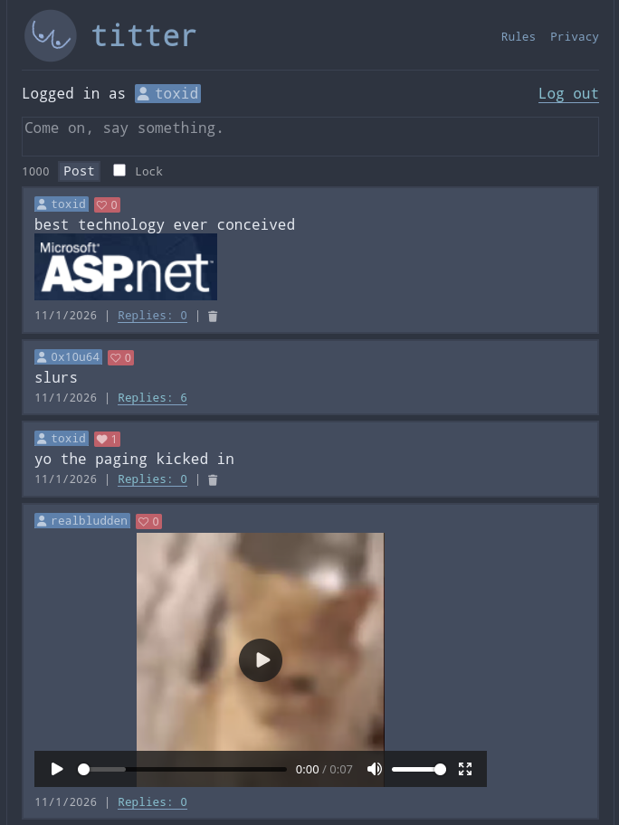

# Titter
A small social network built with ASP.NET Core MVC

## Features
- Accounts with ASP.NET Core Identity
- Posts with replies and markdown (via Markdig)
- Authors can lock their threads so nobody but OP can reply
- Fully working likes tied to accounts
- Profile pages, rules and privacy policy

## Stack
- ASP.NET Core MVC
- Entity Framework Core
- Postgres
- HTMX
